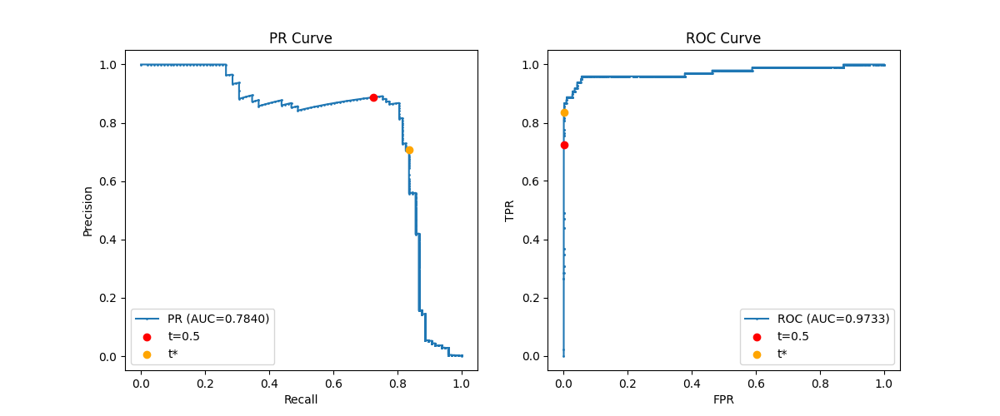

# Лабораторна робота 2
## Поріг рішення під асиметричну ціну помилок

## Інструкція із запуску та відтворення

Проєкт використовує пакетний менеджер `uv` для швидкого керування залежностями. Усі версії бібліотек суворо зафіксовані у файлі `requirements.txt`.

Набір даних: [Credit Card Fraud Detection (Kaggle)](https://www.kaggle.com/datasets/mlg-ulb/creditcardfraud), файл `creditcard.csv` (для завантаження потрібен обліковий запис Kaggle). Сам файл до репозиторію не додано.

### 1. Підготовка середовища

Відкрийте термінал у кореневій папці проєкту та виконайте наступні команди для створення віртуального середовища і встановлення бібліотек:

```bash
uv venv

.venv\Scripts\activate
# (Для Linux / macOS використовуйте: source .venv/bin/activate)

uv pip install -r requirements.txt
```

### 2. Виконання лабораторної роботи

Завдання розділене на два незалежні етапи. Переконайтеся, що файл `creditcard.csv` знаходиться у папці зі скриптами (або передайте інший шлях через `--csv-path`).

**Команда 1: Навчання моделі.** Цей скрипт зчитує датасет, проводить стратифікований поділ, стандартизує дані, навчає нейромережу протягом 12 епох та зберігає ваги й прогнози на диск.

```bash
uv run train.py --csv-path "creditcard.csv"
```

**Команда 2: Аналіз та вибір порога.** Цей скрипт завантажує збережені артефакти (без повторного навчання), будує криві PR та ROC, розраховує оптимальний поріг $t^*$ за $O(n \log n)$, проводить перевірку на малих наборах і генерує фінальну таблицю помилок на тестовій вибірці.

```bash
uv run anal.py
```



## 1. Підготовка даних та стандартизація

Поділ датасету (284 807 транзакцій) виконано у пропорції 60/20/20 зі стратифікацією за класом:

- **Train:** 170884 об'єктів, 295 шахрайств (0.173%)
- **Validation:** 56961 об'єктів, 98 шахрайств (0.172%)
- **Test:** 56962 об'єктів, 99 шахрайств (0.174%)

Чому статистики стандартизації ми обчислююємо лише на train?

Якщо обчислити середнє значення та стандартне відхилення на всьому датасеті, відбудеться витік даних. Модель отримає математичну інформацію про розподіл тестової вибірки ще до початку тестування, що зробить оцінку її якості нереалістично оптимістичною. Стандартизація validation та test має виконуватися виключно за статистиками, отриманими з train.

## 2. Аналіз на Validation та вибір порога

Функція вартості помилок має асиметричний вигляд:

$$C(t) = 10 \cdot FN(t) + FP(t)$$

Чому високе значення ROC-AUC не гарантує малої вартості помилок чи високої точності?

ROC-AUC оцінює загальну здатність моделі ранжувати об'єкти (у нашому випадку 0.9733). Проте на цю метрику дуже сильно впливає асиметрію класів (шахраїв < 0.2%) та асиметрія штрафів. Через величезну кількість легітимних транзакцій навіть мізерний відсоток FP сильно знижує значення метрики Precision.

**Таблиця 1: Правило на validation**

| Правило | Поріг | TP | FP | FN | TN | C |
|---|---:|---:|---:|---:|---:|---:|
| Стандартний поріг | 0.5000 | 71 | 9 | 27 | 56854 | 279 |
| Мінімум вартості ($t^*$) | 0.0312 | 82 | 34 | 16 | 56829 | 194 |
| Усі негативні | $+\infty$ | 0 | 0 | 98 | 56863 | 980 |

## 3. Перевірка реалізації пошуку порога

Пошук за $\mathcal{O}(n \log n)$ через кумулятивні суми був успішно перевірений прямим застосуванням правила $s_i \ge t$ на трьох малих наборах:

1. **Набір A з рівними оцінками:** Алгоритм успішно згрупував дві оцінки 0.7. Найкращий поріг $t^* = 0.4$ ($C=2$).
2. **Набір B без поз. міток:** Алгоритм коректно обрав кандидат $+\infty$ (усі негативні), що дало мінімальну вартість $C=0$.
3. **Набір C:** Вартість $C=10$ досягалася при порогах 0.8 та 0.5. Алгоритм коректно розв'язав нічию, обравши найбільший поріг $t^* = 0.8$.

## 4. Тестова оцінка та аналіз помилок

**Таблиця 2: Тестова оцінка та порівняння**

| Поріг | TP | FP | FN | TN | C | Precision | Recall |
|---|---:|---:|---:|---:|---:|---:|---:|
| t = 0.5 | 71 | 8 | 28 | 56855 | 288 | 0.8987 | 0.7172 |
| $t^* = 0.0312$ | 80 | 43 | 19 | 56820 | 233 | 0.6504 | 0.8081 |
| $+\infty$ | 0 | 0 | 99 | 56863 | 990 | NaN* | 0.0000 |

\* Знаменник Precision при порозі $+\infty$ дорівнює нулю (TP+FP=0), оскільки модель не видає жодного позитивного прогнозу.

**Таблиця 3: Аналіз помилок (перші 5 FP/FN за рядком CSV)**

| Рядок CSV | Тип | Мітка | Оцінка $s$ | Відстань ($s - t^*$) | Amount |
|---:|:---:|---:|---:|---:|---:|
| 460 | FP | 0 | 0.196159 | 0.164965 | 2.00 |
| 2961 | FP | 0 | 0.080961 | 0.049767 | 2.49 |
| 10783 | FP | 0 | 0.966327 | 0.935133 | 89.99 |
| 13405 | FP | 0 | 0.932032 | 0.900838 | 89.99 |
| 13617 | FP | 0 | 0.922762 | 0.891568 | 89.99 |
| 10497 | FN | 1 | 0.011464 | -0.019730 | 3.79 |
| 52521 | FN | 1 | 0.006373 | -0.024821 | 105.99 |
| 55401 | FN | 1 | 0.005642 | -0.025552 | 1.00 |
| 91671 | FN | 1 | 0.000500 | -0.030693 | 290.18 |
| 93486 | FN | 1 | 0.018352 | -0.012842 | 0.00 |

**Висновки щодо аналізу помилок:**

За 10 наведеними прикладами неможливо судити про причину помилок. Пропущені шахрайства, або ж FN, мають вкрай низькі оцінки та невелику негативну відстань до порога, тоді як хибні тривоги (FP) можуть мати оцінки понад 0.9. Сире значення Amount також не є індикатором помилок, адже хибні спрацювання зустрічаються як на малих ($2.00), так і на значних сумах.

Зміщення порога з 0.5 до $t^* = 0.0312$ на тестовій вибірці дозволило виявити 9 додаткових шахрайств (FN зменшилось з 28 до 19). Ціною цього рішення стало суттєве збільшення кількості хибних тривог на 35 випадків (FP зросло з 8 до 43). Оскільки штраф за FN у 10 разів вищий, загальна вартість помилок знизилася з 288 до 233.

Чому результат на validation не гарантує такого самого виграшу на test-ій вибірці?

Вартість помилок на Validation при $t^* $ впала до 194, тоді як на Test вона склала 233. Це сталось через те, що поріг $t^*$ був підігнаний під точний розподіл оцінок валідаційної вибірки. Розподіл даних на тестовій вибірці має природні статистичні відхилення, тому реальна вартість помилок на нових даних завжди є трохи вищою за очікувану.
