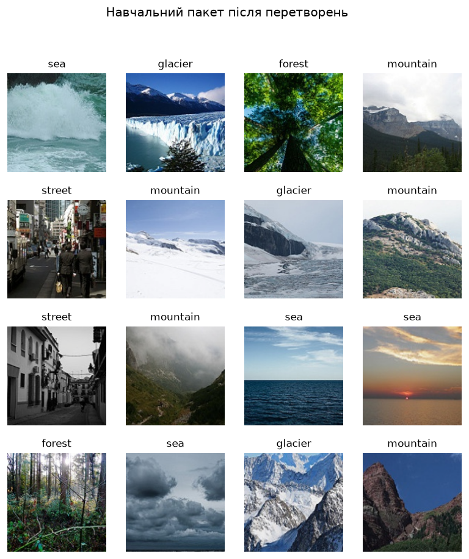
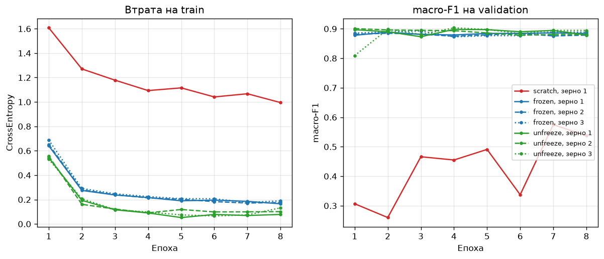
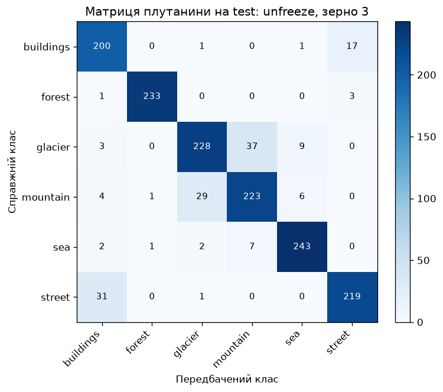
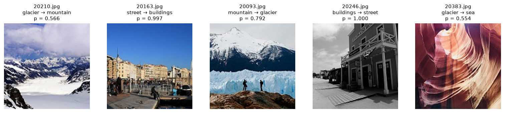

# ЛР3. Обчислювальний експеримент і трансферне навчання

Порівняння трьох режимів навчання ResNet-18 (`scratch`, `frozen`, `unfreeze`) на 1 200 зображеннях
Intel Image Classification за однакового бюджету в 304 кроки оптимізатора.

## Відтворення

Залежності зафіксовано в `pyproject.toml` і `uv.lock` (Python 3.12). Набір до репозиторію не додано:
`--data` указує на теку, що містить `seg_train/` і `seg_test/` (підтримуються обидві структури:
`seg_train/seg_train/<клас>` з архіву Kaggle і `seg_train/<клас>`).

**Навчання**: поділ, перевірки пунктів 1–2, сім запусків, журнали, вибір і `lab3_model.pt`. Test не використовується.

```bash
uv run python train.py --data /шлях/до/набору
```

**Аналіз**: перевірка хешу `split.csv`, таблиця, криві, ефекти, перевірка вибору, тестова оцінка на CPU.
Вивід дублюється в `results.md`; усі тестові числа нижче взято звідти.

```bash
uv run python analyze.py --data /шлях/до/набору
```

### Структура

| Файл | Призначення |
|---|---|
| `config.py` | усі фіксовані налаштування завдання |
| `data.py` | поділ за процедурою, контрольна таблиця, перетворення, набір за `split.csv`, завантажувачі; окремо `uv run python data.py --data <шлях>` лише будує й перевіряє поділ |
| `model.py` | `build_model` (кроки 1–5), `set_train_mode`, групи AdamW, цикл навчання, логіти, macro-F1 |
| `train.py` | команда навчання: перевірки пунктів 1–2 (результати в `checks.json`), сім запусків, журнали `runs/<режим>_seed<зерно>/` (коміт, SHA-256 `split.csv`, версії, пристрій), правило вибору |
| `analyze.py` | команда аналізу: середні, розмахи, Δpre, Δunf, одноразова оцінка на test, матриця плутанини, п'ять помилок |
| `plots.py` | рисунки в `figures/` |

### Середовище й задекларовані відхилення

- Python 3.12.15, PyTorch 2.15.0, torchvision 0.29.2, NumPy 2.5.5, scikit-learn 1.9.1, Matplotlib 3.11.2,
  Pillow 13.0.0. Навчання на Apple MPS (arm64), float32; тестова оцінка на CPU.
- **Хеш коміту.** Сім запусків виконано, коли тека ще не була git-репозиторієм, тому в усіх журналах
  `"code": {"commit": null, "dirty": null}`. Код між запусками не змінювався: усі сім виконано однією командою
  `train.py`. Після цього змінено лише розташування легенди на рисунку кривих (`plots.py`), кодування виводу на UTF-8
  для Windows (`config.py`) і структуру коду: 14 модулів об'єднано в 6 без зміни логіки, коментарі прибрано.
  Після реорганізації `split.csv` (той самий SHA-256), `checks.json` і `results.md` відтворено побайтово.
- **Час навчання** в журналі й таблиці — це повний час восьми епох, включно з оцінкою на validation після кожної епохи.
- Налагоджувальні запуски (1–2 епохи для перевірки коду й оцінки часу) зберігалися поза `runs/` і в таблиці й розрахунки не входять.

## 1. Перевірки до навчання

### Поділ

Контрольна таблиця для `split.csv` («кількість / сума числових імен»):

| Клас | train | validation | test |
|---|---|---|---|
| buildings | 200 / 1 996 761 ✓ | 218 / 4 837 323 ✓ | 219 / 4 837 559 ✓ |
| forest | 200 / 2 032 625 ✓ | 237 / 5 276 962 ✓ | 237 / 5 291 326 ✓ |
| glacier | 200 / 2 183 923 ✓ | 276 / 6 135 652 ✓ | 277 / 6 157 250 ✓ |
| mountain | 200 / 1 950 345 ✓ | 262 / 5 789 535 ✓ | 263 / 5 849 765 ✓ |
| sea | 200 / 1 987 613 ✓ | 255 / 5 655 068 ✓ | 255 / 5 668 011 ✓ |
| street | 200 / 1 841 817 ✓ | 250 / 5 541 845 ✓ | 251 / 5 547 533 ✓ |
| **Разом** | 1200 / 11 993 084 | 1498 / 33 236 385 | 1502 / 33 351 444 |

Усі 18 клітинок збігаються з контрольною таблицею. Жоден файл не входить у дві частини.
SHA-256 `split.csv`: `148dad92de9a18670c177df9f8757aa6519fb0ea6d74a8ba723cfc4453f0a1bc`.

### Пакет після перетворень



Перші 16 зображень навчального пакета після `RandomResizedCrop` і `RandomHorizontalFlip`, з оберненим нормуванням.
Мітки відповідають вмісту зображень.

### Початкова втрата

| Режим | $L_0$ | $\ln 6$ | Відхилення |
|---|---|---|---|
| scratch | 2.0479 | 1.7918 | +0.256 |
| frozen | 1.9244 | 1.7918 | +0.133 |

Обидві втрати трохи вищі за $\ln 6$. Рівно $\ln 6$ дає лише модель з однаковими логітами для всіх класів.
Голова `fc` ініціалізована випадково, а ознаки після `ReLU` і `avgpool` усі додатні. Тому `fc` додає до логітів
**систематичний зсув, спільний для всіх зображень**: деякі класи отримують вищу ймовірність незалежно від
вмісту. Діагностика на тому самому пакеті:

| Режим | Розкид спільного зсуву логітів | Розкид логітів між зображеннями | Середня ймовірність класу street |
|---|---|---|---|
| scratch | 0.48 | 0.22 | 0.073 |
| frozen | 0.46 | 0.45 | 0.096 |

У першому пакеті найбільше street (9 із 32), а випадкова голова в обох режимах дає цьому класу найменшу
ймовірність. Через це втрата вища за $\ln 6$. У scratch ознаки випадкової мережі майже однакові для всіх
зображень (розкид між зображеннями 0.22 проти зсуву 0.48), тож модель дає майже той самий перекошений розподіл
кожному зображенню, і $L_0$ більша. У frozen ознаки ImageNet різняться між зображеннями, частина передбачень
випадково влучає, тому $L_0$ ближча до $\ln 6$. Відхилення порядку 0.1–0.3 пояснюється випадковою
ініціалізацією голови й не вказує на помилку. Помилка з мітками чи нормуванням дала б значно більше значення.

## 2. Перевірка режимів навчання

### Параметри й групи оптимізатора

| Режим | Усього параметрів | requires_grad=True | Групи AdamW (параметрів @ lr) | Заморожених в оптимізаторі |
|---|---|---|---|---|
| scratch | 11 179 590 | 11 179 590 | усі: 11 179 590 @ 3e-3 | 0 |
| frozen | 11 179 590 | 3 078 | fc: 3 078 @ 3e-3 | 0 |
| unfreeze | 11 179 590 | 8 396 806 | fc: 3 078 @ 3e-3; layer4: 8 393 728 @ 3e-4 | 0 |

Усі числа збігаються з таблицею режимів. Жоден параметр із `requires_grad=False` в оптимізатор не потрапив.

### Що змінюється за 5 кроків (`set_train_mode`)

| Режим | Модуль | Параметри змінилися | Ковзні статистики BN змінилися | Збігається з очікуваним |
|---|---|---|---|---|
| frozen | conv1 | ні | немає BN | так |
| frozen | bn1 | ні | ні | так |
| frozen | layer1 | ні | ні | так |
| frozen | layer2 | ні | ні | так |
| frozen | layer3 | ні | ні | так |
| frozen | layer4 | ні | ні | так |
| frozen | fc | так | немає BN | так |
| unfreeze | conv1 | ні | немає BN | так |
| unfreeze | bn1 | ні | ні | так |
| unfreeze | layer1 | ні | ні | так |
| unfreeze | layer2 | ні | ні | так |
| unfreeze | layer3 | ні | ні | так |
| unfreeze | layer4 | так | так | так |
| unfreeze | fc | так | немає BN | так |

### Дослід із навмисною помилкою: frozen зі звичайним `model.train()`

**Прогноз (записано до запуску).** Параметри замороженого кістяка не зміняться, бо їх немає в оптимізаторі й у них
`requires_grad=False`. Але `running_mean` і `running_var` усіх BN кістяка зміняться: у режимі `train()` шар BN
оновлює їх під час прямого проходу. З кривої втрати на train цього не було б видно, бо в режимі `train()` BN нормує
за статистиками пакета, і втрата поводиться звично. Помилка проявиться лише в `eval()`, тобто на validation і test.

**Результат.**

| Режим | Модуль | Параметри змінилися | Ковзні статистики BN змінилися | Збігається з очікуваним для frozen |
|---|---|---|---|---|
| frozen + train() | conv1 | ні | немає BN | так |
| frozen + train() | bn1 | ні | **так** | ні |
| frozen + train() | layer1 | ні | **так** | ні |
| frozen + train() | layer2 | ні | **так** | ні |
| frozen + train() | layer3 | ні | **так** | ні |
| frozen + train() | layer4 | ні | **так** | ні |
| frozen + train() | fc | так | немає BN | так |

У `layer1.0.bn1` після 5 кроків: max |Δ `running_mean`| = 0.0928, max |Δ `running_var`| = 0.1203.

Результат повністю збігся з прогнозом. `requires_grad=False` вимикає лише обчислення градієнта для
**параметрів**, тобто для ваг і зсувів. `running_mean` і `running_var` — це **буфери**, а не параметри. Їх оновлює
не оптимізатор, а сам шар BN у прямому проході в режимі `train()` (експоненційне середнє з `momentum=0.1`).
Тому «заморожений» кістяк у такому разі не заморожений: його нормування поступово дрейфує від статистик ImageNet,
під які навчено ваги, до статистик малих пакетів нової вибірки.

Для `layer4` у режимі unfreeze оновлення статистик правильне: ваги `layer4` навчаються й змінюються, тож
розподіл його активацій теж змінюється. Ковзні статистики мають відстежувати нові активації, інакше в `eval()`
шар нормував би нові ознаки за застарілими середніми й дисперсіями.

## 3. Сім запусків

| # | Режим | Зерно | Втрата train, епоха 8 | macro-F1 validation, епоха 8 | Час навчання, с |
|---|---|---|---|---|---|
| 1 | scratch | 1 | 0.9948 | 0.5373 | 47.1 |
| 2 | frozen | 1 | 0.1655 | 0.8842 | 31.8 |
| 3 | frozen | 2 | 0.1757 | 0.8785 | 31.5 |
| 4 | frozen | 3 | 0.1896 | 0.8886 | 31.2 |
| 5 | unfreeze | 1 | 0.0781 | 0.8791 | 33.6 |
| 6 | unfreeze | 2 | 0.1011 | 0.8807 | 34.3 |
| 7 | unfreeze | 3 | 0.1322 | 0.8946 | 34.3 |

Журнали: `runs/<режим>_seed<зерно>/run.json` (усі налаштування, SHA-256 `split.csv`, версії, історія за
епохами, час) і `val_logits.npy` (1498 × 6, у порядку рядків validation у `split.csv`).



## 4. Розклад ефектів

$$\bar F_r = \frac13\sum_{s=1}^{3} F_{r,s}, \qquad R_r = \max_s F_{r,s} - \min_s F_{r,s}, \qquad R = \max(R_\text{frozen}, R_\text{unfreeze})$$

$$\Delta_\text{pre} = \bar F_\text{frozen} - F_{\text{scratch},1}, \qquad \Delta_\text{unf} = \bar F_\text{unfreeze} - \bar F_\text{frozen}, \qquad \Delta_\text{pre} + \Delta_\text{unf} = \bar F_\text{unfreeze} - F_{\text{scratch},1}$$

| Величина | Значення |
|---|---|
| $F_{\text{scratch},1}$ | 0.5373 |
| $\bar F_\text{frozen}$, $R_\text{frozen}$ | 0.8838, 0.0101 |
| $\bar F_\text{unfreeze}$, $R_\text{unfreeze}$ | 0.8848, 0.0156 |
| $R$ | 0.0156 |
| $\Delta_\text{pre}$ | **+0.3465** |
| $\Delta_\text{unf}$ | **+0.0010** |
| $\Delta_\text{pre} + \Delta_\text{unf}$ | +0.3475 |

- $|\Delta_\text{pre}| = 0.347 > R = 0.016$: ефект вартий перевірки, але за правилом не доведений.
- $|\Delta_\text{unf}| = 0.001 \le R = 0.016$: різниця не відрізняється від розкиду, **результату немає**.

**Що змінює зерно.** Зерно засіює глобальні генератори PyTorch і NumPy на кроці 1. Від нього залежать:

- **scratch:** ініціалізація всіх 11.2 млн параметрів, порядок пакетів і випадкові аугментації (кадрування й відображення).
- **frozen:** кістяк фіксований (ваги ImageNet, BN в `eval()`), тому зерно змінює лише ініціалізацію `fc`, порядок
  пакетів і аугментації. По суті це логістична регресія на майже фіксованих ознаках, тож траєкторії між зернами
  близькі. $R_\text{frozen} = 0.010$.
- **unfreeze:** те саме, що у frozen, але ці відмінності ще й змінюють траєкторію 8.4 млн параметрів `layer4`.
  Більше параметрів, що навчаються, означає більшу чутливість до порядку пакетів, тому $R_\text{unfreeze} = 0.016$
  більший. Це видно й на кривих: запуск 7 після першої епохи мав 0.809, а запуски 5 і 6 — близько 0.90.

**Чому $R$ не характеризує розкид запуску 1.** $R$ виміряно на режимах із попередньо навченим кістяком, де зерно
змінює лише голову, порядок і аугментації. У scratch зерно змінює всю ініціалізацію, і траєкторія значно нестабільніша.
Крива запуску 1 між сусідніми епохами стрибає до 0.24 (0.491 → 0.337 → 0.575 → 0.537), тобто розкид scratch
між зернами майже напевно в рази більший за 0.016. Висновку щодо $\Delta_\text{pre}$ це не змінює. Навіть найкраще
значення scratch за всі епохи (0.575) нижче найгіршого frozen (0.8785) більш ніж на 0.30. Але формально
$\Delta_\text{pre}$ спирається на одне значення scratch, тому його точна величина ненадійна.

**Чи однаковий бюджет за часом.** Ні. Бюджет однаковий за кроками (304), але не за часом: scratch 47.1 с,
frozen у середньому 31.5 с, unfreeze 34.1 с. scratch повільніший, бо зворотний прохід іде через усю мережу.
frozen найшвидший, бо градієнт не обчислюється для кістяка.

## 5. Вибір конфігурації і тестова оцінка

Правило вибору: режим із найбільшим $\bar F_r$ (unfreeze, 0.8848 проти 0.8838 у frozen), а в ньому запуск із
найбільшим $F_{r,s}$. Вибрано **unfreeze, зерно 3** ($F_{r,s} = 0.8946$), ваги збережено в `lab3_model.pt`.
Команда аналізу перевіряє, що файл відповідає правилу вибору за журналами і що його ваги на CPU дають на validation
ті самі передбачення, що й `val_logits.npy` (збіг 100%, macro-F1 0.8946).

**Оскільки $|\Delta_\text{unf}| \le R$, вибір між frozen і unfreeze визначив шум.** frozen з тією самою
ймовірністю міг виявитися «кращим» режимом.

### Test (одноразово, на CPU)

| Величина | Значення |
|---|---|
| macro-F1 на test | **0.8976** |
| macro-F1 на validation вибраного запуску | 0.8946 |
| test − validation | +0.0029 |
| accuracy на test, $p$ | 0.8961 |
| $\text{SE} = \sqrt{p(1-p)/n}$, $n = 1502$ | 0.0079 |

Матриця плутанини (рядки — справжній клас, стовпці — передбачений):

| справжній \ передбачений | buildings | forest | glacier | mountain | sea | street |
|---|---|---|---|---|---|---|
| buildings | 200 | 0 | 1 | 0 | 1 | 17 |
| forest | 1 | 233 | 0 | 0 | 0 | 3 |
| glacier | 3 | 0 | 228 | 37 | 9 | 0 |
| mountain | 4 | 1 | 29 | 223 | 6 | 0 |
| sea | 2 | 1 | 2 | 7 | 243 | 0 |
| street | 31 | 0 | 1 | 0 | 0 | 219 |



**Чи видно оптимістичне зміщення від вибору.** Ні: test навіть трохи вищий за validation. Оцінимо очікуване
зміщення. За $R_\text{unfreeze} \approx 1.69\,\sigma$ маємо $\sigma \approx 0.009$, а максимум трьох нормальних
значень у середньому перевищує їхнє середнє на $\approx 0.85\,\sigma \approx 0.008$. Справді, вибраний запуск
(0.8946) на 0.010 вищий за $\bar F_\text{unfreeze}$. Але стандартна похибка самої оцінки на test (≈ 0.008 для
accuracy) того самого порядку, що й очікуване зміщення. До того ж validation (1 498 зображень) має свою
похибку такого самого розміру. Тому зміщення ховається в шумі скінченної вибірки, і різниця test − validation
може мати будь-який знак.

### П'ять характерних помилок

| Файл | Справжній клас | Передбачений клас | Імовірність передбаченого класу | Кількість таких помилок у test |
|---|---|---|---|---|
| 20210.jpg | glacier | mountain | 0.566 | 37 |
| 20163.jpg | street | buildings | 0.997 | 31 |
| 20093.jpg | mountain | glacier | 0.792 | 29 |
| 20246.jpg | buildings | street | 1.000 | 17 |
| 20383.jpg | glacier | sea | 0.554 | 9 |



- **20210.jpg** (glacier → mountain): **сцена містить обидва класи**. Це льодовикова долина в оточенні гірських
  хребтів. Плутанина glacier ↔ mountain — властивість набору: 66 із 156 помилок на test (42%).
- **20163.jpg** (street → buildings): **сцена містить обидва класи**. Набережна з рядом будинків, які займають
  більшу частину кадру, тому модель упевнено обрала buildings.
- **20093.jpg** (mountain → glacier): **сцена містить обидва класи**. На передньому плані фронт льодовика, за ним
  засніжена гора. Знову властивість набору.
- **20246.jpg** (buildings → street): **сцена містить обидва класи**. Дерев'яна будівля з тротуаром уздовж вулиці.
  Пара street ↔ buildings дає ще 48 помилок (31%).
- **20383.jpg** (glacier → sea): **ймовірна помилка розмітки**. На фото піщаникові стіни каньйону (схоже на
  каньйон Антилопи), льодовика немає. Модель невпевнена (0.554).

Дві пари (glacier ↔ mountain і street ↔ buildings) дають 114 зі 156 помилок (73%).

## 6. Висновок

**Ефект попереднього навчання ($\Delta_\text{pre}$).** Напрям додатний: frozen краще за scratch. Величина
**+34.7 пункту macro-F1** (0.8838 проти 0.5373), що у 22 рази більше за розкид $R = 1.6$ пункту. За правилом
інтерпретації ефект вартий перевірки, але не доведений, бо scratch представлено одним запуском, розкид якого $R$ не
описує. Проте навіть найкраща епоха scratch (0.575) на 30 пунктів нижча за найгірший запуск frozen (0.8785).

**Ефект розморожування ($\Delta_\text{unf}$).** Напрям формально додатний, величина **+0.1 пункту macro-F1**
(0.8848 проти 0.8838), що в 16 разів менше за розкид $R = 1.6$ пункту. Різниця не відрізняється від розкиду:
**результату немає**. Розморожування `layer4` помітно знижує втрату на train (0.08–0.13 проти 0.17–0.19),
але на validation це не переходить.

Обидва ефекти виміряно за конкретного бюджету в 304 кроки. З довшим навчанням scratch міг би скоротити відставання:
його втрата ще спадала, а macro-F1 росла.

Для нової задачі з 200 зображеннями на клас я взяв би **frozen**: за якістю він не відрізняється від unfreeze
в межах розкиду, має менший розкид між зернами (1.0 проти 1.6 пункту), навчається найшвидше (31.5 с проти 34.1 с)
і має лише 3 078 параметрів, що навчаються.

## Використані джерела

- Документація PyTorch і torchvision (`resnet18`, `ResNet18_Weights`, `transforms`, `AdamW`, `BatchNorm2d`),
  scikit-learn (`f1_score`, `confusion_matrix`).
- Текст звіту підготовлено за допомогою генеративного інструмента Gemini Carbon
- Допомога із написанням коду та пояснення можливостей методів - Claude Code
